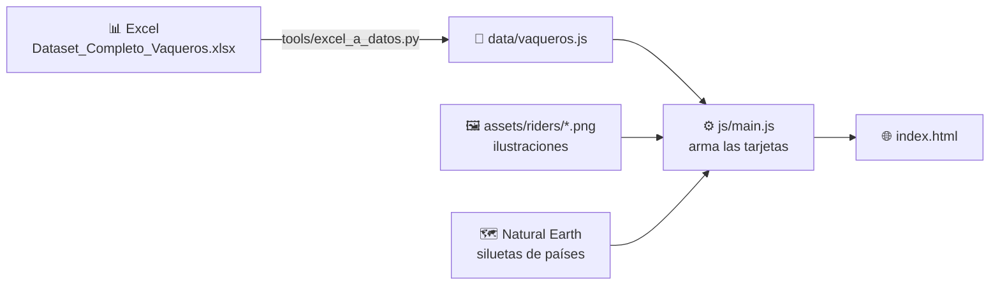

<div align="center">

# 🐎 La gran tradición ecuestre

### Un viaje de tradiciones, caballos y culturas iberoamericanas

*Una misma raíz, múltiples caminos.*

**[🔗 Ver la infografía en vivo](https://silvanaguardia.github.io/La-historia-del-Vaquero/)**


</div>

---

## 📖 Sobre el proyecto

Del jinete íbero al chalán peruano, del gaucho al paniolo hawaiano: la cultura del vaquero viajó de la península ibérica a toda América y se transformó en cada territorio.

Esta infografía interactiva reúne **24 tradiciones ecuestres** de **más de 15 países y regiones**, documentadas con fuentes históricas. Cada tarjeta muestra su época, su región, su vestimenta y su caballo. Al hacer clic se abre una ficha completa con su origen, la presencia femenina, el bioma, los aperos de trabajo, el hito técnico que aportó y una cita de época.

> Es un proyecto de **[SilviData](#-autora)**: data, diseño e historia en un mismo lugar.

## ✨ Qué puedes hacer

| | |
|---|---|
| 🗂️ **Recorrer 24 tradiciones** | Carril horizontal con flechas, trackpad, teclado o deslizando en el celular |
| 🗺️ **Ubicar cada una en el mapa** | La silueta de cada país se dibuja con datos reales de Natural Earth |
| 🔍 **Abrir la ficha completa** | 12 datos por tradición, con íconos y una cita documental |
| 📱 **Verla en cualquier pantalla** | Escritorio, tablet y celular |

## 🧮 Los datos

Toda la información sale de **un Excel propio** con 24 filas y más de 30 columnas:

| Categoría | Columnas |
|---|---|
| 🧬 Origen | Arquetipo, raíz / etnicidad, detalle del mestizaje, presencia femenina regional |
| 🌎 Territorio | País actual, región, bioma / entorno |
| ⏳ Historia | Periodo de consolidación, año / hito clave, documento histórico |
| 👒 Indumentaria | Sombrero, camisa, chaqueta, pantalón, calzado, chaparreras, faja, indumentaria femenina |
| 🐴 Trabajo | Actividad principal, montura, lazo, espuelas, raza de caballo |
| 📚 Fuentes | Hito técnico, fuente documental clave, resumen, cita |

## ⚙️ Cómo funciona

La página **no tiene datos escritos a mano**. Todo se genera desde el Excel:



1. **Excel → JavaScript:** un script de Python lee el Excel, limpia los textos, arma los campos que se derivan (por ejemplo, junta las prendas en una sola frase de indumentaria) y genera `data/vaqueros.js`.
2. **Plantillas HTML:** `index.html` tiene **una sola tarjeta molde**. El JavaScript la copia 24 veces y la rellena con los datos.
3. **Imágenes por convención:** cada ilustración se llama igual que el `id` del vaquero (`chalan.png`, `vaquero-andaluz.png`…), así que no hay que tocar código para agregarlas.

## 📁 Estructura

```
├── index.html                 Estructura: tarjeta molde, ventana emergente, íconos
├── css/styles.css             Estilos: colores, tipografías, responsive
├── js/
│   ├── main.js                Tarjetas, carril horizontal y ventana emergente
│   └── mapas.js               Siluetas de países (TopoJSON → SVG, sin librerías)
├── data/
│   ├── Dataset_Completo_Vaqueros.xlsx   Fuente de los datos
│   └── vaqueros.js            Generado desde el Excel (no se edita a mano)
├── assets/
│   ├── riders/                Ilustración de cada tradición
│   └── ...                    Íconos y adornos
└── tools/
    └── excel_a_datos.py       Excel → data/vaqueros.js
```

## 🚀 Úsalo en tu compu

```bash
git clone https://github.com/SilvanaGuardia/La-historia-del-Vaquero.git
cd La-historia-del-Vaquero
```

Abre `index.html` en el navegador. No necesita servidor ni instalación.

### Actualizar los datos

```bash
pip install openpyxl
python tools/excel_a_datos.py data/Dataset_Completo_Vaqueros.xlsx
```

### Agregar una ilustración

Guárdala en `assets/riders/` con el `id` del vaquero: **en minúsculas, sin tildes y con guiones**. El tamaño recomendado es **430 × 752 px**, en PNG, JPG o WebP.

<details>
<summary>Ver la lista de los 24 ids</summary>

```
jinete-ibero          jinete-andalusi          vaquero-andaluz
campino-do-ribatejo   hatero                   guajiro
vaquero-novohispano   vaqueiro-do-sertao       sabanero
chalan                morochuco                chagra
llanero               gaucho                   huaso
jinete-nativo         gaucho-sul-rio-grandense vaqueiro-pantaneiro
vaquero-californio-y-tejano  chinaco           vaquero-afrodescendiente
paniolo               cowboy-angloamericano    charro
```

</details>

## 🙏 Créditos

- **Investigación, datos e ilustraciones:** Silvana Guardia
- **Mapas:** [Natural Earth](https://www.naturalearthdata.com/), vía [world-atlas](https://github.com/topojson/world-atlas)
- **Tipografías:** Libre Caslon Text, Jost, Nunito Sans y Caveat ([Google Fonts](https://fonts.google.com/))
- **Fuentes históricas:** cada tradición cita su fuente documental en la ficha y en la columna *Fuente Documental Clave* del dataset

## 👩‍💻 Autora

**Silvana Guardia** · creadora de **SilviData**

<!-- Reemplaza los # por tus links -->
[YouTube](#) · [Instagram](#) · [TikTok](#) · [LinkedIn](#)

---

<div align="center">

**Diferentes tierras · Un mismo espíritu**

⭐ Si te gustó, déjale una estrella al repositorio

</div>
